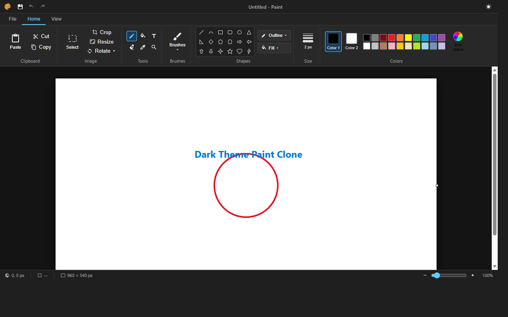

# Windows Paint Clone (Web Edition)

O recreere fidela si modernizata a aplicatiei **Windows 11 Paint** rulata direct in browser, cu Fluent Design, suport complet pentru teme Dark / Light, zoom pe pixeli cu afisare raster/gridline, desen vectorial cu manere interactive de redimensionare, curbe Bezier in 3 pasi, unelte de selectie si export imagini.



## Functionalitati

- **UI & Teme**:
  - Interfata Windows 11 Fluent Ribbon (tab-uri Home / View, grupuri de unelte, selector de culori extins).
  - Comutator complet **Dark / Light Mode** in bara de jos (Status Bar) si scurtatura `Ctrl + Shift + D`.
  - Contrast optimizat pentru elementele de interfata si iconite atat pe tema luminoasa, cat si intunecata.
- **Canvas & Zoom pe Pixeli**:
  - Zoom de la **25% la 800%**.
  - La zoom de peste 400%, pixelii se maresc si devine vizibila grila de pixeli individuali (Pixel Grid).
  - Redimensionare dinamica de canvas cu manere de tragere (dreapta, jos, colt).
- **Unelte de Desenare**:
  - **Pencil, Brush** (Caligrafic, Airbrush, Ulei, Crayon, Marker, Acuarela), **Eraser, Fill Bucket, Color Picker, Text**.
  - **Linii & Forme geometrice cu manere interactive**: dupa trasare, pot fi mutate sau redimensionate inainte de commit (`Enter` sau click in exterior).
  - **Curba Bezier in 3 pasi**: trasezi linia initiala, apoi ajustezi punctul de curbura intermediar.
- **Clipboard & Selectie**:
  - Selectie dreptunghiulara (`Ctrl + A`, `Ctrl + X`, `Ctrl + C`, `Ctrl + V`, `Delete`).
  - Optiune Transparent Selection.
- **Export & Salvare**:
  - Salvare rapida in formatele **PNG**, **JPEG** si **BMP (Bitmap 24-bit)**.

## Rulare

Deschide `index.html` direct in orice browser modern sau ruleaza un server web local:
```bash
npx serve .
```

Pentru versiunea nativa de Windows Desktop cu Electron, consulta branch-ul `windows-electron`.
